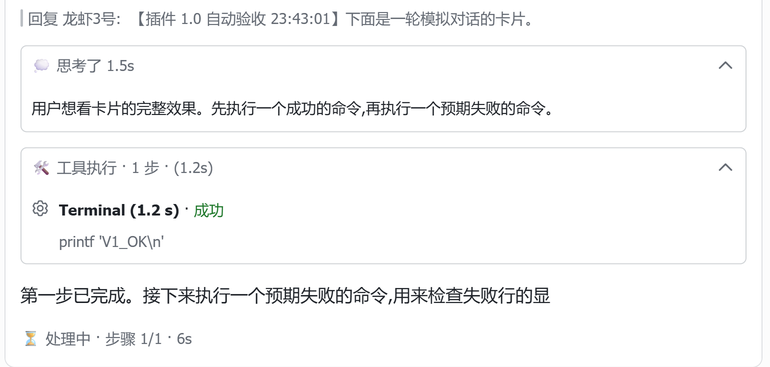
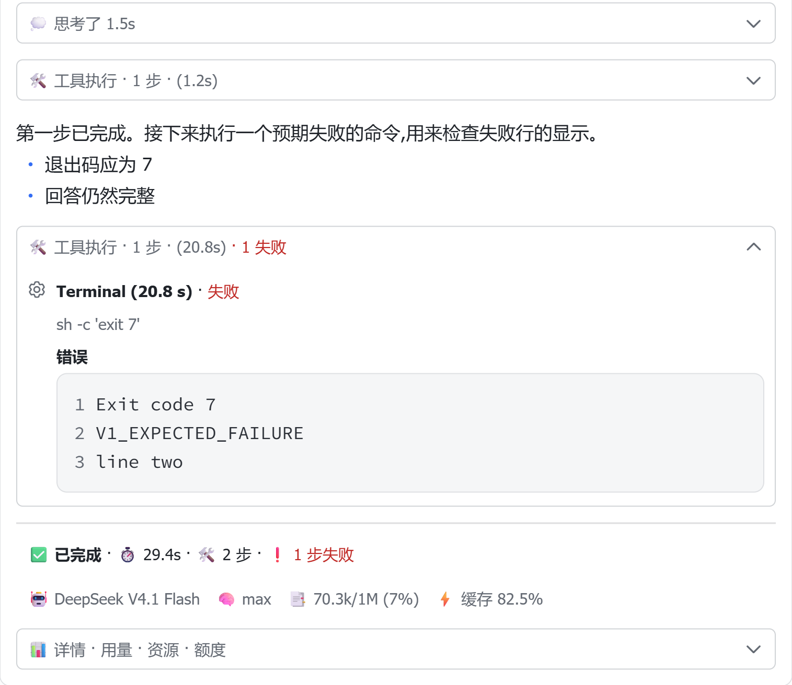
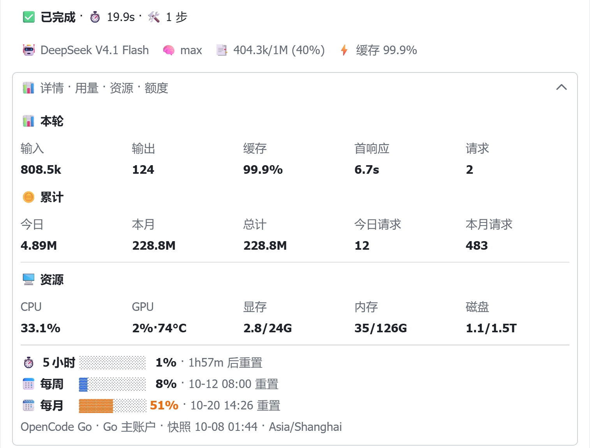
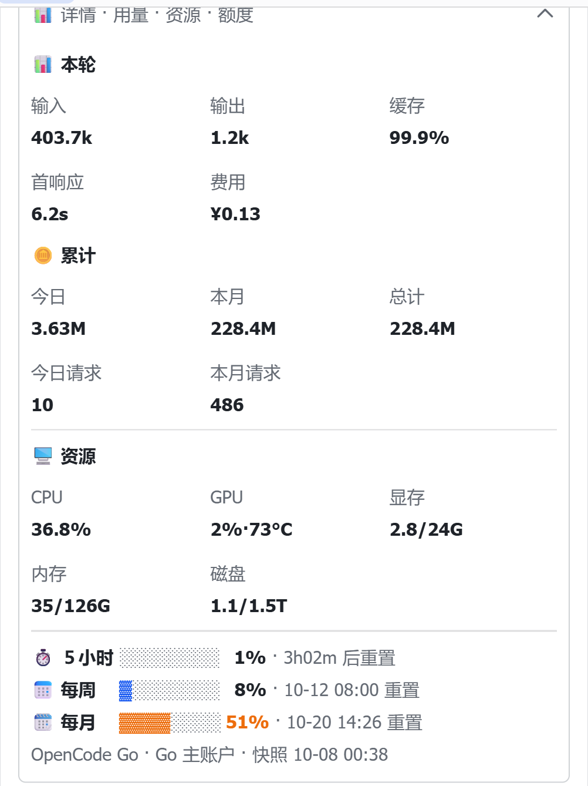

# Hermes Lark Streaming

让 Hermes 的飞书回复成为一张持续更新的卡片:思考、工具、回答按发生顺序排列,最后一行状态页脚。

[安装](INSTALL.md) · [配置](docs/CONFIG.md) · [架构](docs/ARCHITECTURE.md) · [更新记录](CHANGELOG.md)

> 1.0 是完全重写。旧版(0.21.x)的三套布局合并为一套,配置键同步精简,旧配置不兼容,迁移见 [升级说明](docs/MIGRATION.md)。

## 卡片长什么样

沿用原项目最初的样式:没有标题栏,内容按发生顺序排列,最后一条分隔线和一行状态页脚。下面是飞书桌面端真实截图(测试群里的模拟对话):

| 运行中 | 已完成 | 有工具失败 |
|---|---|---|
|  |  |  |

- **时间线**:`💭 思考了 1.6s` 面板、`🛠️ 工具执行 · N 步 · (耗时)` 面板(每个工具一行:图标、**名称 (耗时)** · 成功/失败,下面一行灰色命令)、回答文字,按实际发生顺序交替出现。
- **运行中**:面板展开,回答逐字输出,底部一行 `⏳ 正在执行 Terminal · 步骤 2/3 · 12s`。
- **完成后**:面板折叠;有失败的工具面板保持展开,标红并给出错误输出。
- **中途补充**:回合进行中再发的消息由 Hermes 并入这一轮,卡片照常继续,并在时间线上显示 `💬 你补充 · …`。
- **长任务**:一轮对话一张卡片(流式窗口结束后继续局部更新);工具面板只完整显示最近 8 步;状态行显示正在运行的工具已运行多久;Agent 列了任务清单时显示 `📋 任务清单 · 3/7 完成`;底部 `⏹ 停止` 按钮等同 `/stop`。
- **页脚提醒**:额度紧张时 `⚠️ 额度 93%`,订阅快到期时 `⏳ 订阅剩 2 天`;回答附带的文件列为 `📎 产出`。
- **子代理**:`🔀 子代理` 面板,每个子代理一行(运行中 / 完成 / 失败、目标、步数、耗时、最近工具或结论);后台子代理在主对话结束后继续刷新这个面板。
- **额度与线路**:页脚显示在用订阅 key 与其 5 小时窗口(`Go 221 · ⏳ 5小时 37%`),中途换线路时时间线注明原因与恢复时间;日报开头列出线路状态。
- **Hermes 通知并入卡片**:卡片运行时 Hermes 自己发的短通知(忙碌回执、记忆召回、进程回执、额度提醒等)变成卡片里的一行灰字 `📣 …`,不再单独成条;审批、追问、长文本和没有卡片在跑时照常单独发。
- **后台回合**:后台子代理全部完成后的汇总、后台进程通知各自出一张卡片,开头注明来由;汇总卡片附同一批子代理的结果面板。
- **页脚**:状态行 `✅ 已完成 · ⏱️ 2m 01s · 🛠️ 2 步`(有失败时加 `❗ N 步失败`),下面一排灰色信息块 `🤖 模型 · 服务`(中途切换订阅时为 `OpenDesign → Go`) `🧠 思考强度` `📑 403.7k/1M (40%)` `⚡ 缓存 99.9%`。停止为 `🛑 已停止`,出错为红色 `❌ 出错`。
- **详情**:页脚下方一个折叠的 `📊 详情` 面板。📊 本轮(输入、输出、缓存、首响应,配置单价后还有费用)、🪙 累计(今日、本月、总计 token,今日 / 本月请求数)、🖥️ 资源(CPU、GPU 与温度、显存、内存、磁盘)是“上标签、下数值”的等宽格子,各组列数一致、上下对齐;订阅额度 ⏱️ 5 小时 / 📅 每周 / 🗓️ 每月每个窗口一行进度条和重置时间(≥50% 橙色、≥80% 红色);最后是后台复盘。各分区独立开关,缺失的数据不显示。
- **窄屏不变形**:格子和页脚信息块都是飞书的自适应列。宽屏一行排开;窄屏(手机、分屏、紧凑宽度)格子自动改为每行三个,信息块整块换行。标签和数值不会被拆开,中文词也不会断在两行。

| 默认宽度 | 窄屏 |
|---|---|
|  |  |

## 能力

- 流式更新;飞书流式窗口约 10 分钟,8 分钟时自动换新卡,旧卡封存并提示“内容见下一张卡片”。
- 可靠投递:序号严格递增(结果不明时跳号),稳定 UUID,投递三态台账;结果不明不会重复发送答案。
- 卡片不会一直停在“处理中”:长任务不受时长限制;网关重启或崩溃遗留的卡片在下一条消息到来时标记为“已中断”,已显示的内容保留。
- 打断、`/stop`、排队后续、审批与 clarify 边界、后台任务、Cron 结果都以卡片呈现。
- 消息被删除或撤回后自动停止更新;创建失败时交还 Hermes 默认回复。
- 工具参数、错误与输出一律先脱敏再转义;只读采集,不开后台进程,不自动换号。

## 配置

写在 Hermes 的 `config.yaml` 中:

```yaml
streaming:
  enabled: true
  text_size: normal_v2      # 正文字号
  width_mode: default       # default | compact | fill
  process: auto             # auto | open | closed | off
  details:
    usage: true
    resources: false
    timezone: Asia/Shanghai
    accounts:
      enabled: false
      allowed_chats: []     # 账户额度必须显式列出会话
```

其余键见 [配置参考](docs/CONFIG.md)。Hermes 自带的 `display.show_reasoning`、`display.show_tool_use` 仍然生效。

## 运行要求

Hermes ≥ 0.21.3(模块化网关布局),Python ≥ 3.11,飞书应用具备 CardKit、消息收发与图片权限。凭据沿用 Hermes 现有配置,不额外保存。

## 开发

```bash
python -m venv .venv && .venv/bin/pip install -e ".[dev]"
.venv/bin/python -m pytest tests -q
.venv/bin/ruff check hermes_lark_streaming tests
.venv/bin/mypy --explicit-package-bases hermes_lark_streaming
```

用量报告:`hermes --run-module hermes_lark_streaming report --chat <chat_id> [--period day|week]` 发一张用量卡片(不经过模型),可交给定时器每天发送。

真实验收不需要人工发消息:`scripts/live_acceptance.py <chat_id>` 用真实飞书接口走一轮模拟对话,`scripts/preview_card.py <chat_id> --width compact|default` 发一张展开详情的示例卡片看排版。

## 许可

MIT。灵感来自 [Cheerwhy/hermes-lark-streaming](https://github.com/Cheerwhy/hermes-lark-streaming)、[openclaw-lark](https://github.com/larksuite/openclaw-lark) 与 [hermes-feishu-streaming-card](https://github.com/baileyh8/hermes-feishu-streaming-card)。
